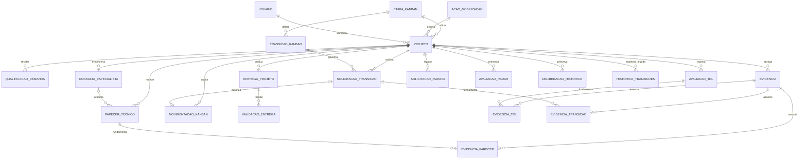

# SIGES-PIN — Documentação técnica final da Fase 1

**Camada:** domínio, persistência e integridade do portfólio 
**Revisão:** 21/10/2026 
**Stack:** Java 21, Spring Boot 3.3.4, Spring Data JPA, Hibernate, PostgreSQL e Flyway

## 1. Projeto e objetivo desta etapa

O SIGES-PIN organiza o portfólio de inovação da BBTS ao longo da entrada e qualificação das demandas, análises técnicas, experimentação, governança e validação das entregas. Esta primeira fase implementa o modelo persistente que representa esses conceitos e mantém o histórico necessário para que as próximas camadas processem as iniciativas com segurança.

O fluxo do domínio acompanha as orientações do PRO663-009 e contempla dois mecanismos de entrada: demandas espontâneas e ações induzidas, como campanhas, desafios, hackathons e residências.

Esta entrega contém entidades JPA, enums, repositórios Spring Data, migrations versionadas, constraints, índices, proteção do histórico e testes de persistência. Os serviços de negócio completos, a API REST, DTOs, autenticação JWT, autorização, integração com IA e armazenamento físico de arquivos serão implementados em fases posteriores. A existência de uma entidade para um fluxo futuro não significa que já exista uma tela ou endpoint para operá-lo.

## 2. Perfis e responsabilidades

Os perfis são valores da entidade `Usuario`; não são entidades separadas.

| Perfil | Responsabilidade prevista |
|---|---|
| `DEMANDANTE` | Registra necessidades, problemas e oportunidades, fornece contexto ao longo da jornada e valida resultados e MVPs. |
| `ANALISTA` | Faz a triagem e qualificação, avalia aderência à tese, relevância, inovação, viabilidade e maturidade, consulta Especialistas, acompanha experimentos, avalia TRL e opera o portfólio. |
| `ESPECIALISTA` | Emite pareceres técnicos e decide solicitações de transição Kanban que exigem governança. |

Usuários autenticados poderão consultar todos os projetos do portfólio. Essa decisão descreve a regra de produto, ainda não uma autorização implementada. A consulta global não implica permissão para alterar os projetos.

Na V3, `COMITE` foi convertido em `ESPECIALISTA` e `EXECUTIVO` em `ANALISTA`. A segunda conversão amplia as responsabilidades do perfil; a equipe deve revisar esses usuários antes de habilitar permissões. Os IDs, projetos e históricos foram preservados. Os campos financeiros permanecem no domínio, mas sua exposição por perfil depende da definição dos futuros DTOs e da política financeira.

## 3. Conceitos usados no código

### Entidade JPA e tabela

Uma classe com `@Entity` representa registros persistidos. `@Table` define a tabela; `@Id` identifica a linha; `@GeneratedValue(IDENTITY)` delega a geração do identificador ao PostgreSQL. `@ManyToOne` e `@JoinColumn` representam referências a outros registros por chave estrangeira. Relacionamentos são carregados sob demanda com `FetchType.LAZY` para evitar trazer grafos inteiros sem necessidade.

Os campos Java descrevem o mapeamento ORM. As migrations Flyway criam as constraints reais. Um `nullable = false` no mapeamento ajuda o Hibernate a entender o domínio, mas não substitui a constraint SQL.

### Enum

`@Enumerated(EnumType.STRING)` persiste o nome do valor do enum. Isso torna os valores compreensíveis no banco, mas renomear uma constante exige avaliar os dados e criar uma migration compatível. Usamos enums para opções fechadas, como perfil, origem, tipo de transição e resultado de validação. As etapas do Kanban são entidades, pois podem ser configuradas pelos usuários.

### Repository

Um repository Spring Data declara operações de leitura e persistência sem implementar SQL repetitivo. Ele estende `JpaRepository<Entidade, Long>`, herdando operações CRUD. Métodos como `findByProjetoId` instruem o Spring Data a compor uma consulta pela propriedade. Métodos com `Pageable` devolvem páginas; o serviço ainda deve escolher limites e ordenação úteis.

O repositório não é uma camada de autorização. Perfis, autoria, atribuições e regras de negócio serão conferidos nos serviços e na segurança.

### Migration e Flyway

Flyway aplica scripts SQL ordenados por versão e registra o resultado em `flyway_schema_history`. A V1 cria o domínio original; a V2 adiciona solicitações de avanço; a V3 evolui o domínio conforme o feedback do cliente; a V4 corrige e fortalece a montagem dos conjuntos documentais. Scripts já aplicados não devem ser editados: uma mudança subsequente é outra migration.

### Constraints e transações

Chaves estrangeiras e `CHECK` protegem a consistência mesmo quando uma escrita não passa pelo serviço esperado. Índices aceleram consultas. Triggers são usados apenas onde uma regra de integridade requer coordenar várias tabelas ou preservar registros. O `@Version` implementa concorrência otimista no JPA: duas sessões editam a mesma versão e a sessão obsoleta deve receber conflito.

O banco não sabe qual pessoa está autenticada. Validar perfil, usuário ativo, atribuição do Analista e identidade do Demandante exige a futura camada de serviço/segurança.

## 4. Fluxo dos usuários

### Entrada e qualificação

Uma demanda **espontânea** nasce de um problema, necessidade ou oportunidade registrada por um Demandante. Uma demanda **induzida** vem de uma ação de mobilização, como um desafio ou hackathon. Os dois tipos podem aguardar triagem: backlog é uma situação de trabalho, não uma origem.

O Analista registra uma qualificação textual, preservando as análises de aderência à tese, relevância, grau de inovação, viabilidade/factibilidade e maturidade. Quando precisa de conhecimento especializado, encaminha uma pergunta ao Especialista, que pode responder com parecer técnico fundamentado. Parecer é subsídio técnico, não autorização de governança.

### Evolução de maturidade e Kanban

O Analista atualiza o TRL à luz dos resultados e evidências. Cada avaliação registra o valor anterior e o novo, o autor, a justificativa e a data. O TRL vai de 1 a 9; reduções justificadas são permitidas. Não há pedido de autorização de governança para cada avaliação.

O projeto ocupa uma etapa do Kanban configurável. As etapas iniciais são Ideação, POC, MVP, Concluído e Descontinuado. Analista e Especialista poderão acrescentar colunas ao mesmo quadro do portfólio. `TransicaoKanban` define quais movimentos são possíveis e se cada um exige governança. Para a configuração inicial, as transições previstas exigem governança; nenhuma transição sem governança foi presumida.

O Analista pode propor transições que exijam governança. Um Especialista aprova ou rejeita com justificativa. Aprovação deverá mudar a etapa e registrar a movimentação na mesma transação; rejeição mantém a etapa atual. Para uma transição configurada sem governança, o Analista poderá movimentar o projeto diretamente. Regras de autorização e a operação atômica pertencem aos futuros serviços.

### Entregas

Uma entrega ou MVP é submetida para validação do Demandante, dono do problema. A validação registra um resultado e observações e pode ser repetida, preservando as respostas anteriores. Validar uma entrega não aprova tecnicamente o projeto nem muda o Kanban automaticamente.

## 5. Modelo de entidades e relacionamentos

As referências de autoria e responsabilidade para cada entidade aparecem nos campos listados a seguir; foram omitidas do diagrama para facilitar a leitura.

### Entidades centrais

| Entidade | Dados e responsabilidade |
|---|---|
| `Usuario` | Nome, email único, hash de senha, perfil e estado ativo. `senhaHash` é interno e nunca deve ser enviado ao front-end. |
| `Projeto` | Título, problema, área, PO existente, Demandante, Analista responsável, arena, origem, ação de mobilização, etapa Kanban, TRL atual, hipótese, indicador Lei do Bem, dispêndio e datas. Responsáveis podem ser nulos em registros antigos ainda não atribuídos. |
| `AcaoMobilizacao` | Nome e descrição de uma campanha, desafio, hackathon, residência ou mecanismo equivalente para demandas induzidas. |
| `EtapaKanban` | Código e ID estáveis, nome, ordem, estado ativo, natureza terminal opcional e versão. Etapas referenciadas não são excluídas; podem ser inativadas. Código e natureza terminal são estáveis para não reinterpretar históricos. |
| `TransicaoKanban` | Par único de origem e destino, exigência de governança, estado ativo e versão. A configuração inicial contém cinco etapas e seis transições governadas: três avanços normais e três possibilidades de descontinuação. |

### Avaliações e colaboração

| Entidade | Dados e responsabilidade |
|---|---|
| `QualificacaoDemanda` | Autor, projeto, textos dos critérios de triagem, fundamentação, conclusão e data. Cada nova análise cria um registro histórico. |
| `ConsultaEspecialista` | Projeto, solicitante, Especialista destinatário, questão e data do encaminhamento. |
| `ParecerTecnico` | Autor, projeto, fundamentação, conclusão, data e consulta opcional ao Especialista. Consulta e parecer podem ter vários registros ao longo da jornada. |
| `AvaliacaoTrl` | Projeto, autor, nível anterior, nível avaliado entre 1 e 9, justificativa e data. Uma redução é válida se justificada; avaliações passadas são imutáveis. |
| `Evidencia` | Referência ao projeto, nome do arquivo, endereço de armazenamento, tipo e data. O binário fica fora do PostgreSQL. |
| `EvidenciaTrl` | Associação entre avaliação de TRL e arquivo do mesmo projeto. |
| `EvidenciaParecer` | Associação entre parecer técnico e arquivo do mesmo projeto. |

### Kanban, decisão e validação

| Entidade | Dados e responsabilidade |
|---|---|
| `SolicitacaoTransicao` | Projeto, autor, transição configurada, origem/destino e exigência de governança congelados como fotografia da configuração, justificativa, situação, dados de encerramento e versão. Somente uma solicitação pendente por projeto é permitida. |
| `MovimentacaoKanban` | Auditoria das mudanças novas: projeto, autor, origem/destino, justificativa e data; associa-se opcionalmente ao pedido aprovado. É a fonte do histórico novo do Kanban. |
| `EvidenciaTransicao` | Associação entre pedido de transição e arquivo do mesmo projeto. Só pode ser criada enquanto o pedido está pendente. |
| `EntregaProjeto` | Projeto, autor, descrição da entrega/MVP e data de submissão. |
| `ValidacaoEntrega` | Projeto, entrega, Demandante, resultado, observações e data. Várias validações podem permanecer no histórico. |

### Histórico e compatibilidade

| Entidade | Responsabilidade |
|---|---|
| `SolicitacaoAvanco` | Pedidos mistos de TRL/etapa da V2. Permanece somente para leitura, com dados e evidências preservados. Não participa do novo fluxo. |
| `HistoricoTransicoes` | Preserva as auditorias da V1/V2. `MovimentacaoKanban` é a fonte de auditoria para movimentos do Kanban criados na V3 em diante; não duplicar um novo movimento nas duas tabelas. Avaliações de TRL são preservadas em `AvaliacaoTrl`. |
| `DeliberacaoHistorico` | Preserva as decisões gerais existentes. Pareceres técnicos e solicitações de transição possuem entidades próprias no fluxo novo. |
| `AvaliacaoRadar` | Mantém as leituras e escalas que já existiam. Não foi reinterpretada como qualificação nem convertida em pontuação de triagem. |

### Enums

| Enum | Valores |
|---|---|
| `PerfilUsuario` | `DEMANDANTE`, `ANALISTA`, `ESPECIALISTA` |
| `ArenaTipo` | `EFICIENCIA_OPERACIONAL`, `NEGOCIOS_DIGITAIS`, `SEGURANCA_INTEGRADA`, `A_DEFINIR` |
| `OrigemDemanda` | `ESPONTANEA`, `INDUZIDA` |
| `TipoTerminal` | `CONCLUSAO`, `DESCONTINUACAO` |
| `StatusSolicitacao` | `PENDENTE`, `APROVADA`, `REJEITADA`, `CANCELADA` |
| `TipoMudanca` | `STATUS_FUNIL`, `TRL`; conserva os valores históricos da auditoria antiga |
| `ResultadoValidacao` | `VALIDADA`, `VALIDADA_COM_RESSALVAS`, `NAO_VALIDADA` |
| Enums preservados | `StatusFunil` (legado), `DecisaoTipo` e `TipoLeituraRadar` |

Os rótulos finais de resultado de validação e as regras específicas para cada campanha ainda podem ser ajustados conforme a validação do cliente.

## 6. Repositórios e consultas

Cada entidade operacional tem um repositório Spring Data com consultas adequadas ao uso: consulta por projeto e paginação para históricos; fila por situação para solicitações; ordenação para etapas e transições. Métodos herdados permitem persistir registros e buscar por ID.

| Entidade | Repositório |
|---|---|
| `AcaoMobilizacao` | `AcaoMobilizacaoRepository` |
| `EtapaKanban` | `EtapaKanbanRepository` |
| `TransicaoKanban` | `TransicaoKanbanRepository` |
| `QualificacaoDemanda` | `QualificacaoDemandaRepository` |
| `ConsultaEspecialista` | `ConsultaEspecialistaRepository` |
| `ParecerTecnico` | `ParecerTecnicoRepository` |
| `AvaliacaoTrl` | `AvaliacaoTrlRepository` |
| `SolicitacaoTransicao` | `SolicitacaoTransicaoRepository` |
| `MovimentacaoKanban` | `MovimentacaoKanbanRepository` |
| `EntregaProjeto` | `EntregaProjetoRepository` |
| `ValidacaoEntrega` | `ValidacaoEntregaRepository` |
| `EvidenciaTrl` | `EvidenciaTrlRepository` |
| `EvidenciaParecer` | `EvidenciaParecerRepository` |
| `EvidenciaTransicao` | `EvidenciaTransicaoRepository` |

Os três repositórios de associação de evidência são justificáveis quando a interface ou o serviço precisa paginar os arquivos vinculados a uma avaliação, parecer ou solicitação. Eles agora oferecem consultas tanto por projeto como pelo registro específico. A tabela de associação continua importante porque armazena e garante que o registro e a evidência pertencem ao mesmo projeto.

`ProjetoRepository.findAllWithFilters` consulta globalmente com paginação e filtros opcionais de arena, etapa e texto de busca. Não há filtro obrigatório de proprietário. `HistoricoTransicoesRepository` e `SolicitacaoAvancoRepository` permanecem para os dados históricos; não devem ser usados como novos históricos ou fila de decisão.

Um repository não precisa conter lógica de negócio. A validação de perfil e responsabilidade, a transação de fechamento de evidências, a autorização e a atualização atômica do projeto pertencem aos serviços futuros.

## 7. Integridade e comportamento dos registros

### Avaliação/parecer e conjunto de evidências

A V3 tentava garantir a mesma transação usando `xmin` e `pg_current_xact_id()`. O teste isolado encontrou uma diferença com savepoint: uma linha criada dentro de subtransação pode ter um `xmin` diferente do ID da transação principal. A V4 remove essa comparação.

Agora `AvaliacaoTrl` e `ParecerTecnico` têm o campo `evidenciasFechadas`. Um registro novo inicia aberto; a aplicação pode anexar evidências do mesmo projeto e então fechá-lo uma única vez. Um constraint trigger adiado verifica no commit que o registro está fechado. Depois do fechamento, não se pode editar ou excluir o registro nem adicionar, editar ou remover seus vínculos documentais. A relação fica imutável e o conjunto examinado fica definido.

Essa sequência pode usar transações aninhadas e savepoints: os triggers consultam o estado de fechamento, não metadados internos da versão da linha. A camada de serviço ainda precisa executar a sequência completa sob `@Transactional`. A constraint adiada impede que uma avaliação/parecer aberto seja confirmado isoladamente no banco.

### Preservação de história e concorrência

Avaliações, pareceres, pedidos encerrados, validações, movimentações e vínculos documentais são registros históricos. `@Immutable` no Hibernate evita atualizações ORM em certas entidades; triggers e constraints PostgreSQL protegem escritas diretas para os casos críticos. Para os pais documentais de TRL/parecer, a V4 permite apenas a transição controlada de aberto para fechado.

Associações e referências ao arquivo possuem chaves estrangeiras compostas com `projeto_id`, prevenindo que um arquivo de outro projeto seja usado em um parecer, avaliação, entrega ou pedido. Metadados de um arquivo já utilizado por uma referência histórica não podem ser alterados. O arquivo físico no S3 ainda depende de uma etapa futura.

`@Version` em Projeto, EtapaKanban, TransicaoKanban e SolicitacaoTransicao detecta atualizações concorrentes pelo JPA. O serviço deve converter conflito em resposta compreensível e carregar o valor atual de novo. Escritas SQL diretas devem respeitar o número de versão.

As constraints de origem garantem que `INDUZIDA` tenha ação de mobilização, `ESPONTANEA` não tenha uma, e origem nula represente legado sem informação. A constraint de CHECK deve testar também a presença dos campos: no PostgreSQL uma expressão CHECK que resulta em NULL passa.

## 8. Migrações e dados existentes

| Migration | Efeito |
|---|---|
| `V1__criar_tabelas_iniciais.sql` | Cria usuários, projetos, decisões, radar, auditoria e evidências iniciais. |
| `V2__adicionar_solicitacoes_avanco.sql` | Introduz solicitações mistas de TRL/Kanban e referências complementares. |
| `V3__evoluir_dominio_portfolio.sql` | Converte perfis; introduz origem, mobilização, etapas e transições configuráveis, qualificação, consultas, pareceres, avaliações TRL, validações e tabelas de associação; preserva solicitações antigas como legado. |
| `V4__fechar_conjuntos_de_evidencias.sql` | Substitui a regra interna baseada em `xmin` pelo fechamento explícito e transacional de evidências de avaliações e pareceres. |

V1, V2 e V3 permanecem imutadas. Em instalação nova, Flyway executa as quatro versões em sequência. Em um banco já migrado até V3, aplica somente V4.

Os projetos existentes têm seu status convertido para a etapa correspondente. Os perfis COMITE/EXECUTIVO são convertidos como descrito na seção de usuários. A origem histórica fica nula, pois não há dados para inferi-la. Não são criadas avaliações de TRL retroativas. Pedidos antigos, pendentes ou encerrados, e suas referências são preservados e congelados fora do fluxo novo. A mudança de perfil é compatibilidade de dados, não confirmação de que cada usuário convertido já recebeu orientação ou treinamento.

## 9. Fronteira entre banco e serviços

| Regra | Camada responsável |
|---|---|
| TRL entre 1 e 9 e links de evidência no mesmo projeto | Banco (CHECK/FK) |
| Avaliação/parecer com conjunto de evidências fechado no commit | Banco (constraint trigger V4) e sequência transacional no serviço |
| Um pedido pendente de transição por projeto | Banco (índice parcial único) |
| Snapshot do pedido consistente com uma transição ativa e governada | Banco na inserção do pedido |
| Não sair de etapa terminal; não excluir etapa referenciada | Banco (triggers/FK) |
| Leitura global autenticada para os três perfis | Ainda não implementado; segurança/serviço |
| Usuário ativo, perfil, Demandante dono do problema e Analista atribuído | Ainda não implementado; segurança/serviço |
| Criar demandas novas com origem explícita e validar perfis da mobilização | Ainda não implementado; serviço |
| Atualizar TRL e projeto atomicamente, conferir nível anterior e autoria | Ainda não implementado; serviço transacional |
| Aprovação movimenta o projeto e grava auditoria atomicamente | Ainda não implementado; serviço transacional |
| Autorizar governança e impedir caminhos diretos | Ainda não implementado; segurança/serviço |
| Limites e ordenação das páginas, contratos JSON e datas com fuso | Pendente de alinhamento da API |
| Exposição de `dispendioEstimado` | Pendente de política financeira e DTOs |

Os endpoints REST antigos e as propostas do guia do front-end não são contratos implementados. Devem ser revisados junto com DTOs e serviços antes de integrar o front-end.

## 10. Conceitos importantes de persistência implementados

- **Responsabilidades separadas:** qualificação, parecer técnico, avaliação de maturidade, pedido de governança, movimentação, entrega e validação contam histórias distintas; nenhuma tabela única tenta representar todos os processos.
- **Fotografia histórica:** a solicitação de transição armazena origem, destino e exigência de governança que valiam quando foi solicitada. Editar a configuração mais tarde não altera o pedido antigo.
- **Integridade referencial:** chaves estrangeiras ligam os registros e impedem associações entre projetos diferentes.
- **Histórico append-only:** entradas encerradas preservam autoria e conteúdo; correções devem virar novos registros nos fluxos que são históricos.
- **Controle de concorrência:** `@Version` ajuda a detectar quando uma segunda sessão está tentando salvar uma cópia antiga.
- **Transação:** uma sequência relacionada deve ser confirmada por inteiro. Na V4, um parecer/avaliação e seus anexos só se tornam um conjunto válido quando é fechado antes do commit.
- **Backfill conservador:** a migration converte o que pode ser determinado sem inventar origem, maturidade ou decisão para registros antigos.
- **Persistência não é autorização:** um FK confirma que o usuário existe; não confirma que esse usuário tenha o perfil correto para a ação.

## 11. Verificação

A execução final desta revisão usou `mvnw.cmd -B clean verify`, Java 21.0.12.1 e PostgreSQL 16.11 em um container descartável local, com a variável `SIGESPIN_TEST_DB_URL` apontando exclusivamente para esse banco. Resultado: `BUILD SUCCESS`, quatro testes executados, zero falhas, zero erros e zero ignorados.

A suíte cobre a instalação vazia e aplicação sequencial de V1–V4; migração de dados existentes de V2 para V4 preservando solicitações e histórico legado; validação de mapeamento Hibernate/JPA, inicialização dos 21 repositórios, consultas globais e concorrência otimista; constraints de relações entre projetos, transições de Kanban e concorrência de solicitações; e abertura, anexação, fechamento e imutabilidade dos conjuntos de evidências.

O primeiro ciclo revelou um conflito entre o gatilho histórico da V3 e o fechamento documental permitido na V4. A V4 foi ajustada para substituir aqueles gatilhos pelos controles documentais específicos; a suíte completa passou após recriar o banco de teste vazio. Testes não devem apontar para banco corporativo ou compartilhado.

Essa validação confirma a camada de domínio, migration e persistência prevista para esta fase; não comprova fluxos REST, serviços transacionais de negócio, permissões por perfil, JWT, IA ou armazenamento S3, ainda não implementados.

## 12. Fases do projeto

| Fase | Escopo | Situação |
|---|---|---|
| **Fase 1 — Camada de domínio e persistência** | Entidades, enums, repositórios Spring Data, migrations Flyway, constraints de integridade e testes de persistência. | **Concluída e validada** com Java 21 e PostgreSQL 16 descartável. |
| **Fase 2 — Segurança e autenticação** | Spring Security, autenticação JWT, ciclo de login e autorização dos perfis Demandante, Analista e Especialista, mantendo a consulta global do portfólio. | Pendente. |
| **Fase 3 — Serviços e regras de negócio** | Serviços transacionais para intake, qualificação, pareceres, evidências, avaliação de TRL, fluxo de governança/Kanban, entregas e validação do Demandante. | Pendente. |
| **Fase 4 — API REST** | Controllers, DTOs, validação de entrada, paginação, tratamento uniforme de erros e contratos definidos com o front-end. | Pendente. |
| **Fase 5 — Integração com IA** | Integração do intake com o provedor de IA, validação defensiva das respostas, timeouts e tratamento de indisponibilidade. | Pendente. |
| **Fase 6 — Arquivos e evidências** | Upload e consulta segura de arquivos em armazenamento externo, vínculo com o domínio e preservação de autoria e histórico. | Pendente. |
| **Fase 7 — Dashboard e métricas** | Consultas agregadas do portfólio para indicadores de gestão, acompanhamento e apoio a decisões conforme a alçada do usuário. | Pendente. |

As fases 2 a 7 descrevem o planejamento, não funcionalidades já entregues. A ordem pode ser ajustada conforme dependências técnicas e priorização do cliente; especialmente, os serviços da Fase 3 devem estabelecer as regras transacionais consumidas pela API da Fase 4.

Este arquivo é o documento canônico da Fase 1. Ele substitui as documentações anteriores e reúne contexto do projeto, roadmap das fases, decisões, conceitos implementados, entidades, migrations e limitações atuais.
